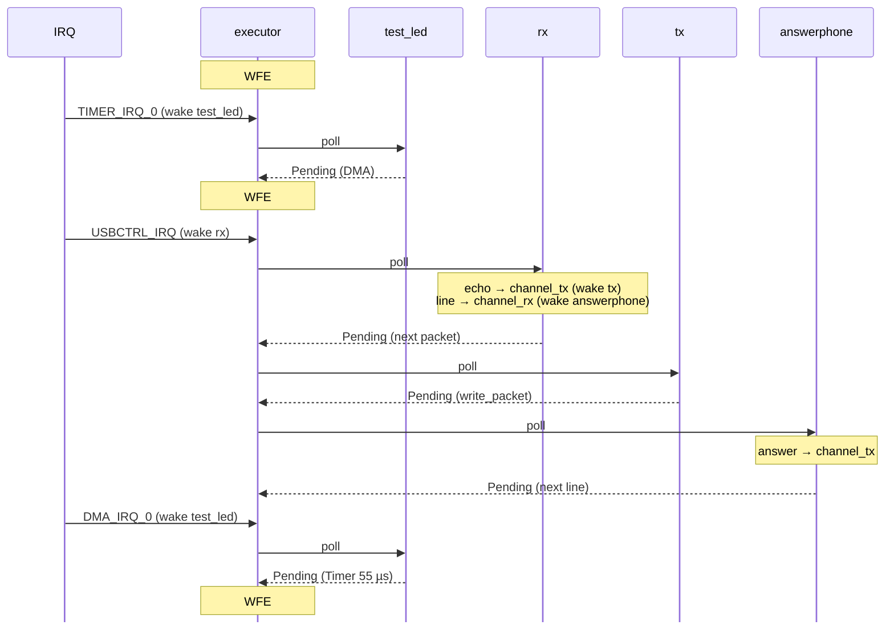

<div align="center">
    
</div>

The life of the board, in order: from power on to the tasks, then the loop
that runs forever. Each step is explained in its own doc, linked here. The
words (IRQ, `WFE`, XIP…) are in [RP2040.md](./RP2040.md).

### Two Phases

```
  power on / RESET
        │
  ┌─────▼─────────────── boot (once) ───────────────────┐
  │ bootrom → boot2 → Reset → executor → main task      │
  └─────┬───────────────────────────────────────────────┘
        │
  ┌─────▼─────────────── run loop (forever) ────────────┐
  │ poll the woken tasks → WFE (sleep) → IRQ → wake ─┐  │
  │      ▲                                           │  │
  │      └───────────────────────────────────────────┘  │
  └─────────────────────────────────────────────────────┘
```

| Phase | Runs | Who | Ends |
|---|---|---|---|
| Boot | Once, a few ms | bootrom, boot2, `cortex-m-rt`, `main` | When `main` returns |
| Run loop | Forever | The executor and the tasks | Never (only a reset or a power off) |

<div align="center">
    
</div>

### Boot

#### From Power to `main()`

```
  power on / RESET button
     │
  bootrom                        in the chip, read only
     │  BOOT held? ──yes──> BOOTSEL: USB drive, waits for a .uf2
     │  copies the first 256 B of flash to RAM, checks the CRC
     │      └── bad CRC ──> BOOTSEL too
  boot2                          256 B, in the flash (.boot2)
     │  sets up the QSPI for this flash chip, enables XIP
     │  points the CPU to the vector table (0x1000_0100)
  Reset handler                  cortex-m-rt, entry 1 of the table
     │  __pre_init (empty)
     │  zeroes .bss              statics at 0, task futures
     │  copies .data             statics with a value: flash → RAM
     │  bl main
  fn main() -> !                 written by #[embassy_executor::main]
```

Details: [BUILD.md](./BUILD.md#the-boot) (boot2, `memory.x`),
[INTERRUPTS.md](./INTERRUPTS.md#the-vector-table) (the table).

#### From `main()` to the Tasks

Our `async fn main` is **not** the `main` called by `Reset`. The macro writes
a real `fn main() -> !` that creates the executor, and turns ours into its
**first task**:

```
  fn main() -> !                         (generated)
     │  executor = Executor::new()
     │  executor.run(|spawner| spawn(our main))
     │
     └──> loop { poll; WFE }  ──> first poll: our async main runs
                                    │
         async fn main(spawner)     │
            │  embassy_rp::init()   clocks 12 → 125 MHz (PLL)
            │                       time driver: TIMER_IRQ_0 on
            │                       DMA, GPIO set up
            │  Pio::new, Led::new   the LED drivers
            │  spawn(test_led)
            │  usb::Driver, Builder the USB device
            │  spawn(usb_run)
            │  spawn(serial_rx_run, serial_tx_run)
            │  spawn(answerphone)
            └─ returns: the main task is done, its slot is free
```

| Step | Crate | Replaces in rp-hal |
|---|---|---|
| `Reset`, `.bss`, `.data` | `cortex-m-rt` | Same (`#[entry]`) |
| Executor created | `embassy-executor` | Nothing: rp-hal had no executor |
| `embassy_rp::init` | `embassy-rp` | `init_clocks_and_plls`, `Watchdog::new`, `Timer::new` by hand |
| `spawn` | `embassy-executor` | Nothing: everything was in the main `loop` |

Details: [EMBASSY.md](./EMBASSY.md#init-and-the-peripherals).

<div align="center">
    
</div>

### Run Loop

#### The Executor Loop

The whole loop, from `embassy-executor` (`platform/cortex_m.rs`):

```rust
loop {
    self.inner.poll(); // run every task in the run queue
    asm!("wfe");       // sleep until an event
}
```

```
            ┌────────────────────────────────┐
            ▼                                │
     ┌─────────────┐  queue empty   ┌────────┴──────┐
     │    poll     │ ─────────────> │  WFE (sleep)  │
     │ woken tasks │                └────────┬──────┘
     └─────────────┘                         │ IRQ (+ SEV)
            ▲                                ▼
            │      task put in      ┌───────────────┐
            └────── run queue ───── │  IRQ handler  │
                                    │  waker.wake() │
                                    └───────────────┘
```

- `poll` runs **only the woken tasks**, each one until its next `.await`
  that returns `Pending`. A task that is not woken costs nothing.
- `WFE` stops the core until an event. An interrupt is one, and `wake()`
  also sends `SEV` (in `__pender`), so the core never sleeps with a task
  waiting in the queue.

#### What Wakes the Core

Only interrupts. Each async driver waits for its own line:

| Line | Fired when | Wakes |
|---|---|---|
| `TIMER_IRQ_0` | The alarm time is reached | Any task in `Timer::after`, `Ticker::next` |
| `DMA_IRQ_0` | The DMA copy is done | `test_led` in `ws.write()` (then a 55 µs `Timer`) |
| `PIO0_IRQ_0` | A PIO FIFO or IRQ flag needs the CPU | The PIO futures (not awaited in `Led` today) |
| `USBCTRL_IRQ` | Bus reset, setup packet, a packet sent or received | `usb_run`, `serial_rx_run`, `serial_tx_run` |

**One alarm for all the timers.** The time driver uses only alarm 0 of the
hardware timer. Embassy keeps the timers of all the tasks in a queue, and the
alarm is set to the **earliest** one. When it fires, the due tasks are
woken and the alarm is set to the next one.

```
  timer queue      task A 5 ms     task B 1000 ms
                         │
  alarm 0  ──────────────┘   (only the earliest)
```

Details: [INTERRUPTS.md](./INTERRUPTS.md) (lines and handlers).

#### One Wake-Up

One frame of `led.fade()`: a `Ticker` every 5 ms (`LED_FADE_FRAME`), then
`ws.write()`, which waits **twice**: the DMA copy, then 55 µs for the WS2812
to latch the color.

```
  time ─────────────────────────────────────────────────────────────►
       │◄──────────────────────── 5 ms ─────────────────────────►│

  core 0  ░ WFE ░│█│░ WFE ░│█│░ WFE ░│█│░░░░░░░░ WFE ░░░░░░░░░░│█│ …
                  ▲  │      ▲  │     ▲  │                         ▲
  test_led        │  │      │  │     │  └ ticker.next() ─ Pending │
                  │  │      │  │     └ write() returns            │
                  │  │      │  └ Timer 55 µs ─ Pending            │
                  │  │      └ DMA done                            │
                  │  └ next color, DMA started ─ Pending          │
                  │                                               │
  IRQ        TIMER_IRQ_0  DMA_IRQ_0  TIMER_IRQ_0             TIMER_IRQ_0
             (ticker)                (55 µs)                 (ticker)
```

`█` is the CPU working: a few µs each. The rest of the 5 ms, the core
sleeps. Three wake-ups per frame, 200 frames per second.

#### Several Tasks

The tasks share the core: they never run at the same time, each `.await`
lets the next one run.

Here the LED fades while Enter is typed in the terminal. An interrupt wakes
`serial_rx_run` (`rx`). The two others are woken with **no interrupt**: `rx`
puts the echo and the line in the channels, which wakes the tasks waiting on
them ([SERIAL.md](./SERIAL.md)).



<div align="center">
    
</div>

### rp-hal vs Embassy

With rp-hal, the run loop was ours: a `loop` that never slept and checked
everything at each turn.

```
  rp-hal                              embassy
  loop {                              loop {          (executor)
      usb_dev.poll(…)  every turn         poll woken tasks
      if timer done { led… }              WFE
      if count_down { … }             }
  }                                   tasks: one per job, woken by IRQs
  CPU at 100 %, always                CPU asleep most of the time
```

| | rp-hal | Embassy |
|---|---|---|
| Who loops | Our `main` | The executor |
| Waiting | Polling the registers / `CountDown` | `.await`, the core sleeps (`WFE`) |
| A new job | One more `if` in the loop | One more task |
| A slow job | Delays the whole loop | Delays the other tasks too, if it doesn't `.await` |

<div align="center">
    
</div>

### Points to Keep in Mind

- **`main` returning is normal.** The executor keeps running, the tasks live
  in their `static` slots.
- **No `.await`, no switch.** A long computation between two `.await`s blocks
  every other task, the USB too.
- **A task that is never woken never runs again.** If a driver's interrupt
  isn't bound, its future stays `Pending` forever: nothing crashes, the task
  just stops (see [INTERRUPTS.md](./INTERRUPTS.md)).
- **Only core 0.** Core 1 stays asleep since the boot: a second executor
  could run on it later.

<div align="center">
    
</div>
