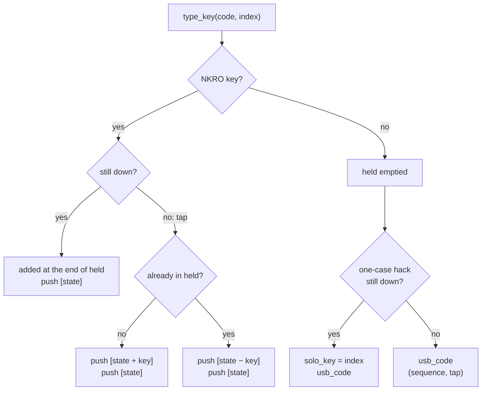
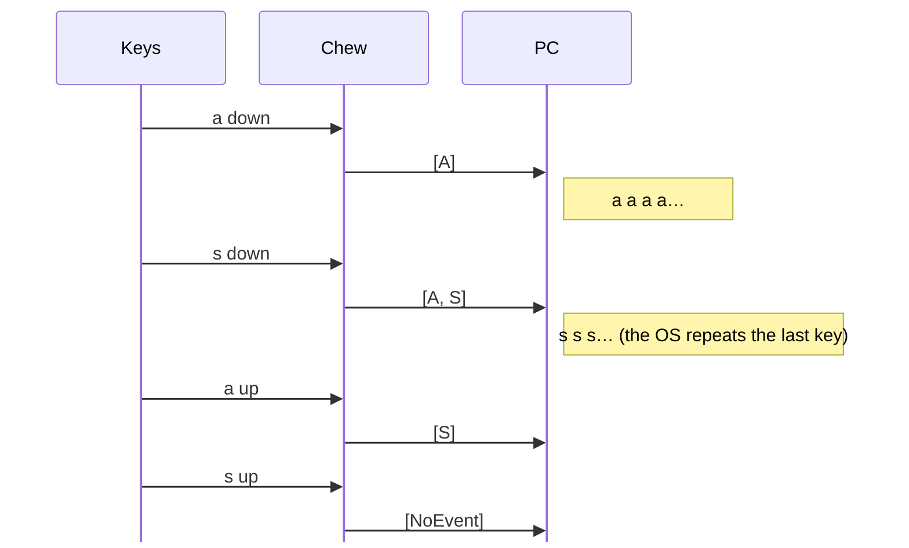
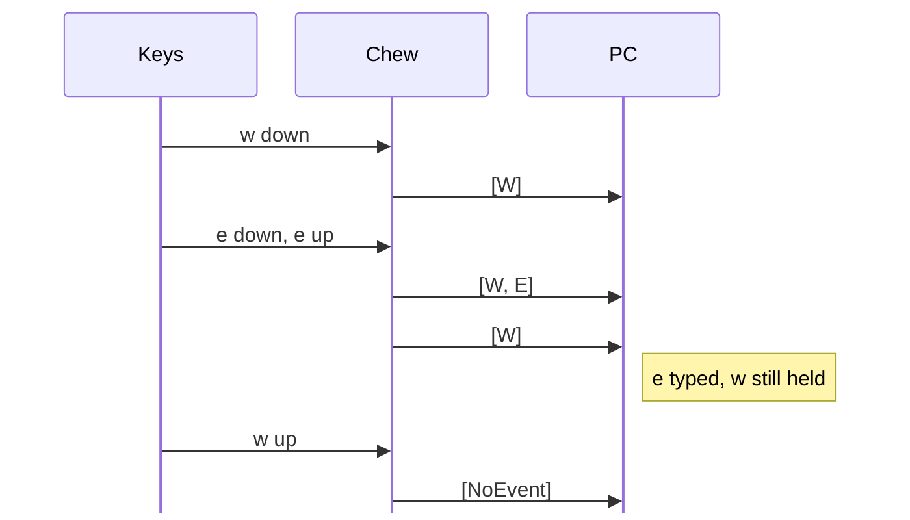
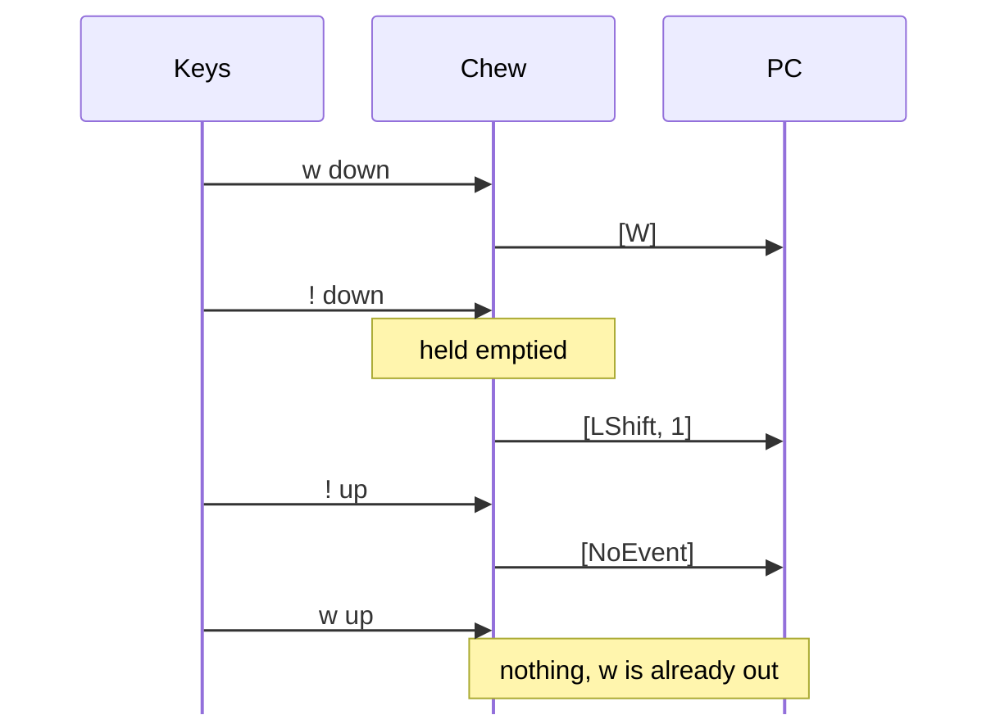
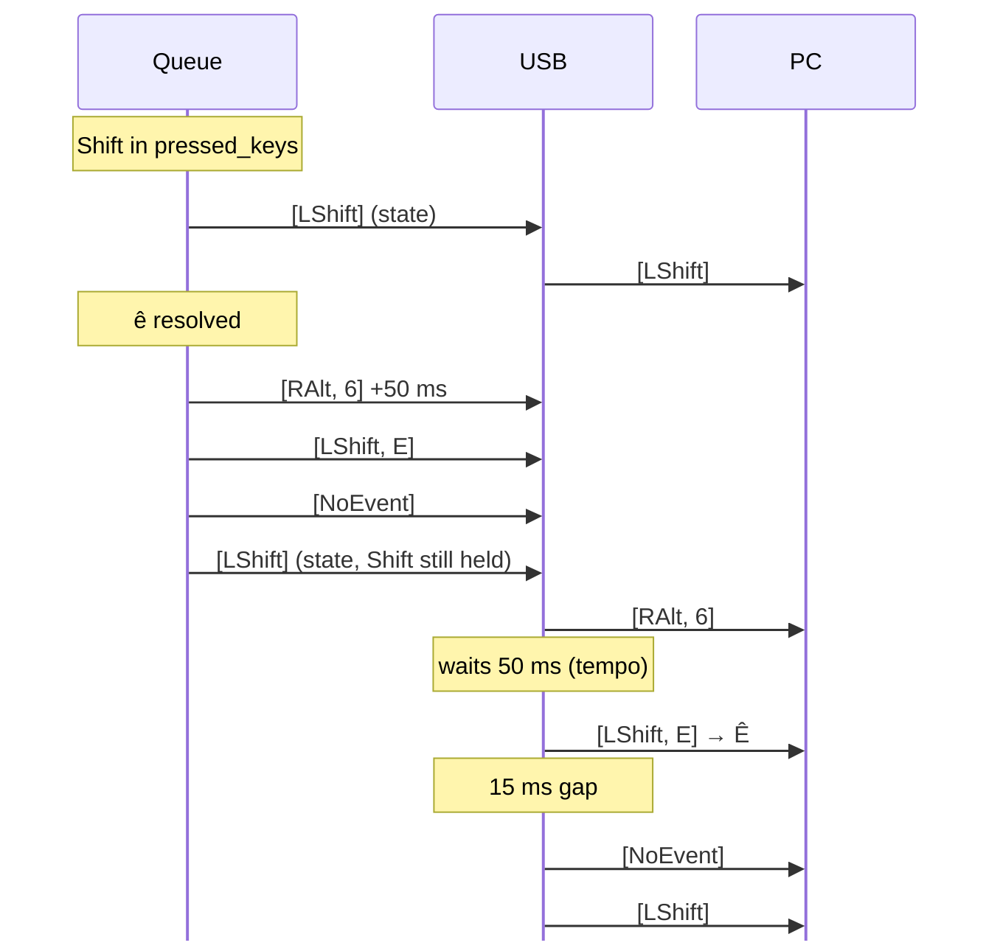

<div align="center">
    
</div>

How a pressed key becomes a USB report.

### Overview

```
 matrix ──► update_matrix ──► run() ──► Nkro ──────► key_buffer (queue) ──► USB loop ──► computer
 (keys)     pre-pressed →      hacks     held keys   BuffCase, BuffCase…    1 report
            pressed                                                         ≥15 ms apart
```

The firmware does two things with the same queue:

- it **types**: a hack (accent, symbol, macro…) pushes one or more reports,
  each with its own pause, and the USB loop sends them one by one,
- it **holds**: `Nkro` keeps the plain keys still down (letters, arrows,
  Enter…) and pushes the state (mods + held keys) each time it changes, so
  several keys can be held together (see [4](#4-held-keys-nkro)).

Two rhythms:

- **Produce:** `chew.run` runs at each matrix update (every 5 ms on split,
  when the slave's keys arrive). It **pushes** cases into the queue.
- **Send:** the USB loop **pops** one case as soon as the last one is
  `TIMER_USB_LOOP` (15 ms) old, or its `tempo` if longer.

<div align="center">
    
</div>

### 1. From the matrix to `pressed_keys`

`Chew::update_matrix` (`src/software/chew.rs`):

1. A new key enters `pre_pressed_keys` with `ticks: 1`.
2. Each update adds the elapsed ticks to every key (pre-pressed, pressed, home
   row).
3. After `COMBO_TIME` (20 ms) a pre-pressed key moves into `pressed_keys`.
   Until then, a combo can catch it.
4. Released keys and `KC::Done` keys are removed. `KC::DoneButKeep` stays
   (layer keys, mouse speed: they matter as long as they're held).
5. `mods.update_state` drops the modifiers whose key is released.

#### The 5 ms samples

The matrix is read every 5 ms (`TIMER_MONO_LOOP` on mono, each exchange with
the slave on split), so `ticks` jump by 5 between two updates. The thresholds
keep their real duration, rounded up to the next sample:

```
 sample           1     2     3     4     5        one every 5 ms
 first key ticks  1     6     11    16    21 > 20 → pressed_keys
 second key       ✔     ✔     ✔     ✔     ✘        too late for a combo
```

- A key resolves 20-25 ms after its press: up to 5 ms before it's seen, then
  `COMBO_TIME`.
- **The combo window is 4 samples:** the second key must be seen while the
  first is at 16 at most. That's 15 ms between samples, so 10 to 20 ms between
  the two presses, depending on where they fall between samples. A combo that
  sometimes doesn't trigger can come from there.
- Only multiples of 5 change something: `COMBO_TIME` = 22 behaves like 25.
- Keys first seen in the same sample lose their real order: they come in the
  order of the matrix (on split, the master's keys first, then the slave's).
- `HOLD_TIME` (150 ms) moves by 5 ms at most, too little to feel.

### 2. The hacks

`Chew::run`, in this order:

1. **Layout:** each pre-pressed key gets its `KC` from the current layer.
2. **Combos:** two pre-pressed keys matching `COMBOS` are both set to `Done`
   and replaced by one key in `pressed_keys`.
3. **Layers:** `Layout`, `LaySet`, `LayDead` set `layout.number`. A dead layer
   stays active for one key after its key is released.
4. **Leader key:** while active, letters fill `leader.buffer` and are set to
   `KC::None` (nothing typed). A matching sequence adds a key with
   `index: usize::MAX` (no matrix key, so it's a tap).
5. **Dynamic macros:** record or replay. A replay pushes its cases with
   `usb_code`, so it's a sequence: the held keys are emptied (`nkro.clear()`).
6. **Modifiers:** `Alt` / `Altgr` / `Ctl` / `Gui` / `Sft` keep their **matrix
   index** in `Modifiers` (`src/software/modifiers.rs`), not a bool. A modifier
   is released when *its* key is released, even if the layer changed in
   between.
7. **Home row:** a home-row key waits in `homerow`:
   - held ≥ `HOLD_TIME` (150 ms) → becomes a modifier, the keys queued
     after it are typed with it,
   - released earlier → typed as its letter, with the queued keys after it.
   - While `homerow` isn't empty, the other keys queue there too, so the order
     is kept.
8. **Regular keys:** `nkro.type_key` is called once per key, then the key is
   set to `Done`.
9. **NKRO:** `nkro.update` removes the released keys and pushes the state if
   it changed.

### 3. Building a report

`KC::usb_code` → `Buffer::add` (`src/software/keys.rs`).

One `BuffCase` = **one full HID report** (`key_code`, up to
`BUFFER_CASE_LENGTH` = 16 codes) **+ a `tempo`**, the pause to wait *after*
sending it.

```rust
key_code = mods.active() - excluded_mods  +  the key's own codes
```

| Key                 | Cases pushed |
|---------------------|--------------|
| `A`, Shift held     | `[LShift, A]`, by `Nkro` (+ the other held keys) |
| `Num1`              | `[1]`, Shift excluded |
| `Exclaim`           | `[LShift, 1]` |
| `EAcute`            | `[RAlt, E]`, RAlt excluded from the mods and given explicitly |
| `ECircum` (ê)       | `[RAlt, 6]` + `TEMPO_DEAD_KEY` (50 ms) → `[mods, E]` → `[NoEvent]` |
| `Tion`              | `[T]` → `[I]` → `[O]` → `[N]` → `[NoEvent]`, Alt / Ctrl / Gui excluded so the letters can't become shortcuts |
| Text macro          | one case per character, `[NoEvent]` between two identical letters, a final `[NoEvent]` (`src/software/macros.rs`) |
| `KC::None`          | `[NoEventIndicated]` = everything released |

<div align="center">
    
</div>

### 4. Held keys (NKRO)

A report is **a state**, not an event: the computer keeps the last one until
the next one. `Nkro` (`src/software/nkro.rs`) decides which state it sees.

#### Three kinds of keys

A report has **one modifier byte for all its keys**. A key with its own
modifiers can't share a report: `!` = `[LShift, 1]` would turn a held `a`
into `A`.

| Kind | Which keys | Behaviour |
|---|---|---|
| **NKRO key** (`is_nkro_key`) | one code, no modifiers of its own: letters, Enter, Space, Esc, Del, Tab, Home / End / PageUp / PageDown, arrows, F1-F24 | **held together**, in `held` (up to `NKRO_MAX_KEYS` = 11) |
| **One-case hack** | a single case with excluded or added mods: `Num0`-`Num9`, symbols, `EAcute`, `CCedilla`, `STab`… (`k < KC::ACircum`) | held **alone** (`solo_key`) |
| **Sequence** | several cases ending with `[NoEvent]`: dead-key accents, `Qu`, `Tion`, text macros, dynamic macro replay (`k >= KC::ACircum`) | typed, never held |

The modifiers held by the user are not a problem: Ctrl + `a` + `s` =
`[LCtrl, A, S]`, the modifier is meant for all the keys.

#### `type_key`: when a key is typed



`state` = `mods.active()` + the held keys, in the order they were pressed.

- **Held key:** a new key comes in its own case, after the keys already
  there. No timer groups keys: a report is an unordered bitmap, two keys
  merged in one case could come out in the wrong order on a roll.
- **Tap:** a key typed after its release (home-row tap, keys queued behind
  it) or without matrix key (leader result). It's added for one case, the held
  keys stay. A tap of a key already held releases it for one case, so it's
  typed once and stays held.
- **Hack or sequence:** `held` is emptied first. If the held keys stayed out of
  its cases only, the next state would add them back: the computer would see a
  second press of a key still held (`w!w`). So they stay out until pressed
  again.
- **NKRO key while a one-case hack is held:** it replaces the hack
  (`solo_key = None`).

#### `update`: end of each run

1. The last case pushed by this run is what the computer has now
   (`last_report`).
2. Released keys leave `held`, a released `solo_key` is cleared. The list
   keeps **matrix indexes**: a key leaves `pressed_keys` one run after it's
   typed (`Done`), the matrix says whether it's still down.
3. No `solo_key`: the state is pushed if it differs from `last_report`,
   `[NoEvent]` when empty.

The modifiers are in the state, so pressing or releasing one pushes a report
too. The mods stay without key: Ctrl + click with the real mouse works.

#### Examples

Hold `a`, then `s`:



Hold `w`, tap `e` (home row, resolved on release):



Hold `w`, then `!` (a sequence like `ê` works the same way):



On split, `a` then `s`, both NKRO keys, no combo between them. The master
runs `update_matrix` + `run` every 5 ms:

| t | Matrix | `pre_pressed_keys` | `pressed_keys` | `held` | Pushed |
|---|---|---|---|---|---|
| 0 | a | a (1) | | | |
| 5-15 | a | a (6 → 16) | | | |
| 20 | a | ~~a~~ (Done) | a (A) → Done | A | `[A]` |
| 25 | a | | | A | |
| 30 | a, s | s (1) | | A | |
| 50 | a, s | ~~s~~ (Done) | s (S) → Done | A, S | `[A, S]` |
| 70 | s | | | S | `[S]` |
| 90 | | | | | `[NoEvent]` |

<div align="center">
    
</div>

### 5. Sending

USB loop in `src/split.rs` (master) and `src/mono.rs`:

```rust
if ticks reached usb_next_ticks {
    pop the first case
    if it differs from last_printed_key → write_report
```

| Result                        | What happens |
|-------------------------------|--------------|
| `Ok`                          | `usb_next_ticks = ticks + max(TIMER_USB_LOOP, tempo)`, `last_printed_key = case` |
| `WouldBlock`, USB suspended   | remote wakeup, **queue emptied** (keys pressed to wake the PC are dropped) |
| `WouldBlock`                  | case put back at the front, tried again at the next loop pass |
| `Duplicate`                   | blue LED, case dropped |

- **Mouse:** written straight away in the run, not through the queue.
- **`rusty_chew.tick()`:** every 1 ms, for the HID crate's own timing.
- **`SERIAL_ON`:** with the `serial` feature, no keyboard report is sent.

#### Minimum gap

There's no USB clock: a report is written as soon as it's allowed, at least
`TIMER_USB_LOOP` (15 ms) after the last one, or the last case's `tempo` if
longer. On the master, over 30 ms (one character = 0.5 ms), `a` then `b`
pressed quickly:

```
ms            0         5         10        15        20        25        30
              |·········|·········|·········|·········|·········|·········|
split request ▼         ▼         ▼         ▼         ▼         ▼         ▼
chew run          ●         ●         ●         ●         ●         ●
pushed            [A]       [A, B]
written           ▲─────────────────────────────▲
                  [A]          15 ms gap        [A, B]
```

- **▼ split request** (`TIMER_SPLIT_LOOP`, 5 ms): STATUS sent, on a 1 ms UART
  tick.
- **● chew run:** about 1-3 ms after the request, when the slave's KEYS mail
  is read. `update_matrix` + `run` push the new cases.
- **▲ written:** `[A]` goes out in the same loop pass as its run, the queue
  was empty and the gap long past. `[A, B]` waits for the 15 ms gap.

So a lone key isn't delayed at all, and the reports of a sequence or a fast
roll stay 15 ms apart (or their `tempo`). Before, the USB loop ran on its own
15 ms clock: a lone key waited for the next slot, 3, 8 or 13 ms on split
(always the same three, since 15 = 3 × 5).

### Example: Shift held, then `ê`



<div align="center">
    
</div>

### Limits

- **Numbers and symbols** stay "one held key at a time" (they exclude or add
  Shift). Fine for typing, a limit for games that use numbers while moving.
  Possible later: a hack joins `held` when its modifiers are already the
  current ones (`Num1` with no Shift held, `!` while Shift is held).
- **Sequences don't repeat:** holding `ê` types one `ê`.
- **Combos:** two keys of a combo pressed within `COMBO_TIME` give the combo's
  key, not both. Pressed one after the other they're held together. For a
  game, use a layer without combos on those keys.
- **Two NKRO keys resolved in the same run** (within one 5 ms exchange on
  split): one case per key, in the order of `pressed_keys`, so their real
  order inside those 5 ms is unknown.
- **OS repeat:** with two keys held, the OS repeats only the last one pressed,
  and stops when it's released, even if the other is still down. Games read
  the keys down / up, not the repeat, so they see both.

### Points to keep in mind

Observations, not confirmed bugs.

- **Latency**, from the press to the computer (+ `HOLD_TIME` for home-row
  keys):

  | Stage | Cost |
  |---|---|
  | Matrix sample | 0-5 ms |
  | Split exchange (split only) | ~1-3 ms |
  | `COMBO_TIME` | 20 ms |
  | USB gap (`TIMER_USB_LOOP`) | 0 ms alone, up to 15 ms behind another report |
  | Host poll | 0-10 ms |
  | **Total** | **about 21-38 ms** for a lone key |

  - **Host poll:** the default `NKROBootKeyboardConfig` of the HID crate sets
    the IN endpoint to 10 ms (`in_endpoint(10.millis())`), so the computer
    reads a report every 10 ms. It can be set with a custom config instead of
    `default()`.
  - HID allows a report every 1 ms, the 15 ms gap is a choice of this
    firmware. Below the host poll (10 ms), the writes would mostly return
    `WouldBlock`.
  - `COMBO_TIME`, `TIMER_USB_LOOP` and the host poll weigh more than the 5 ms
    samples. Each change is a separate test.
- **Throughput:** one report per 15 ms at most is about 66 reports/s. `MacroNixOS`
  (≈ 45 reports) takes about 0.7 s, and keys typed meanwhile wait behind it.
  NKRO pushes one report per change (press, release, modifier), so rolls with
  several keys held can queue up a little. Lowering `TIMER_USB_LOOP` would be
  a separate test.
- **Duplicate check:** `popped_key != last_printed_key` silently skips a case
  identical to the last one sent. That's why macros put `[NoEvent]` between
  two identical letters. NKRO states are only pushed on change and taps end
  with the state, so they don't hit it. A one-case hack typed twice in the
  same run (two `!` queued behind a home-row key) would.
- **Silent drops:** `push_back(...).ok()` drops cases once the queue holds
  `BUFFER_LENGTH` (100).
- **Tick wrap:** the mouse tempos (`ticks >= self.move_tempo`) don't handle
  the `ticks` wrap (after about 49 days on), unlike the USB gap and the rest
  of the code (`wrapping_*`).

<div align="center">
    
</div>
