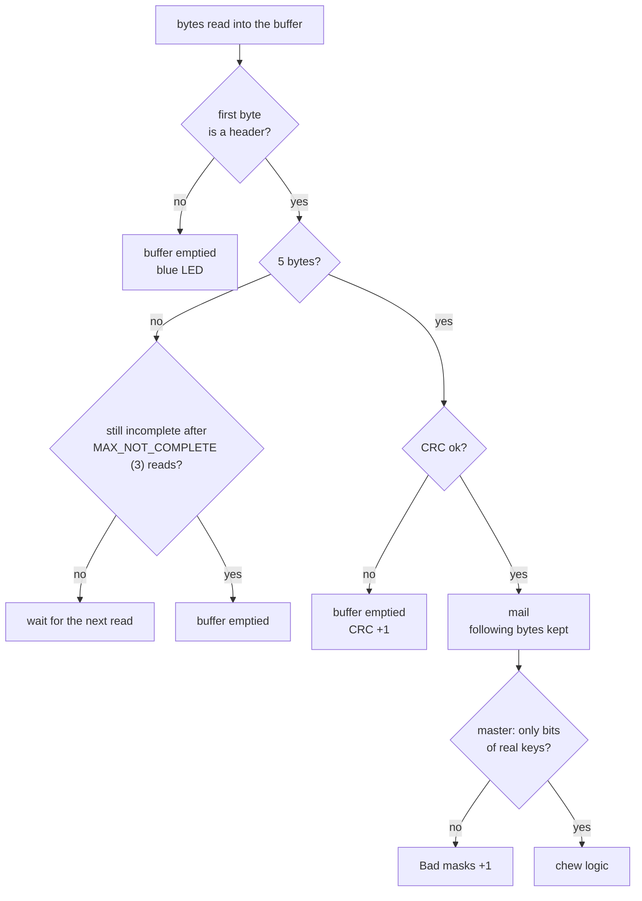
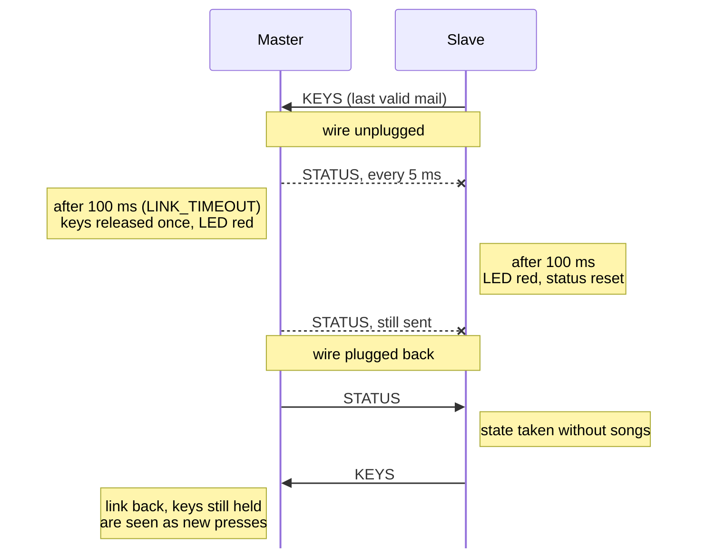

<div align="center">
    
</div>

How the two halves talk over their single data wire.

### Wire

```
        master                                   slave
   SM2 TX ──►──┐            GP11            ┌──◄── SM2 TX
               ├──────── one wire ──────────┤
   SM1 RX ◄────┘  (pull-up: high when idle) └────► SM1 RX
```

- One pin (GP11), half duplex: both halves use the same wire, one at a time.
  The pull-up keeps the line high while nobody sends.
- Own PIO UART, 8N1 at `UART_SPEED` (`src/hardware/half_duplex.rs`), with two
  state machines set up once:
  - SM1 receives all the time, the pin stays an input,
  - SM2 transmits. It sets the level before taking the pin, so switching to
    transmit can't make a false start bit, and releases the pin after each
    stop bit.
- The receiver also hears what its own side sends. This echo is dropped at the
  end of `write`.
- `send()` waits `UART_SEND_DELAY` (100 µs) before a frame, so the other side
  can finish its stop bit, then returns once the frame is on the wire.
- The RX FIFO holds 9 bytes (8 + the shift register), so a frame is kept short.

### Exchange

Only the master starts an exchange, so the two halves never send at the same
time:

```
master                                  slave
  |-- STATUS (request, every 5 ms) -->    |  updates LED & buzzer
  |<-- KEYS (answer, right away) ------   |
  |  runs the chew logic
```

- `TIMER_SPLIT_LOOP` = 5 ms between requests, both sides read their buffer
  every 1 ms (`TIMER_UART_LOOP`).
- A request that gets no answer is counted ("No answer" on serial). The next
  request is the retry.
- The slave never talks on its own, it only answers.

Round trip, from the request to the chew logic:

| Step | At 115200 |
|---|---|
| Master sends (100 µs guard + 5 bytes) | 0.53 ms |
| Slave reads its buffer | 0-1 ms |
| Slave answers | 0.53 ms |
| Master reads its buffer | 0-1 ms |
| **Total** | **1.1-3.1 ms** |

The two 1 ms reads weigh more than the wire: at 921600 the total would still
be 0.3-2.3 ms. A faster UART mainly shortens `send()`, which blocks the master
loop while the frame goes out (about 0.5 ms every 5 ms at 115200).

<div align="center">
    
</div>

### Frame

Every frame is 5 bytes (`src/hardware/uart.rs`):

```
 header      values (3 bytes)                CRC-8
1010 0101 -> 0000 0000 0000 0000 0000 0000 -> 0000 0000
```

- Header: who sends the frame, `HEADER_MASTER` (`0xA5`, STATUS) or
  `HEADER_SLAVE` (`0x5A`, KEYS). Each direction carries a single kind of mail,
  so the header doesn't give a type. It has two other jobs:
  - it marks the start of a frame, so a misaligned buffer is mostly caught
    before the CRC,
  - each side only accepts the other side's header, so a frame read back by
    the side that sent it (echo) is rejected, even though its CRC is valid.
- The two values differ by all 8 bits, and are 4 bits away from `0x00` and
  `0xFF` (line stuck low or high).
- CRC-8, poly 0x07, init 0, over the header and the values.
- The values can be any byte (a key mask can look like a header), so a header
  is only looked for at the start of the buffer.
- After a valid frame, the following bytes are kept for the next one. After a
  bad header or a bad CRC the buffer is emptied, because the frame boundaries
  can't be trusted anymore.

### Mails

The mails are built in `src/software/split_mail.rs`. Both carry a full state,
not an event, so a lost frame only delays a change, it never loses one.

#### STATUS (master → slave): `[status bits, 0, 0]`

| Bit | Status          |
|-----|-----------------|
| 0   | Layout FR       |
| 1   | Layout FN       |
| 2   | Leader key      |
| 3   | Caps lock       |
| 4   | Dyn. macro go, waiting for a key |
| 5   | Dyn. macro recording |
| 6   | Dyn. macro rec, waiting for a key |
| 7   | Buzzer active   |

- LED: the lowest bit set gives the color (the buzzer bit has none), same on
  both halves.
- Songs: the slave compares the bits with the last ones it received
  (`last ^ new`) and plays the song of the lowest changed bit. The first state
  after startup, or after a lost link, is taken without songs.

#### KEYS (slave → master): 17-bit mask on 3 bytes

- Bit n = key at position n of `LEFT_INDEXES` / `RIGHT_INDEXES`.
- Any number of keys fits. The chew logic itself takes 16 pressed keys at
  most.

<div align="center">
    
</div>

### Errors

What `receive()` does with the bytes read, every 1 ms (`src/hardware/uart.rs`):



| Problem | Caught by | What happens |
|---|---|---|
| Flipped bit | CRC | Frame dropped, next request in 5 ms |
| Bit set above the 17 keys | Mask check | Frame dropped ("Bad masks") |
| Unknown header | Header check | Buffer emptied, blue LED |
| No answer | `waiting_answer` | Counted, next request is the retry |
| Link lost | `LINK_TIMEOUT` (100 ms) | See below |

#### Lost link

After `LINK_TIMEOUT` without a valid mail:

- Master:
  - runs the chew logic once with nothing pressed, so no key, modifier or mouse
    button stays stuck,
  - LED red, "Link lost at tick:" on serial,
  - then runs nothing until the slave answers again. It doesn't type alone:
    without the slave's layer keys and modifiers, its own keys would give
    other characters,
  - keeps sending requests, since the slave only comes back by answering one.
- Slave: LED red, its last status bits go back to `None`.

Unplugged, then plugged back:



<div align="center">
    
</div>

### Serial debug

Built with the `serial` feature, the master prints every second:

```
Dropped frames / s - CRC: 0 | Bad masks: 0 | No answer: 0
```

All three should stay at 0 on a good link. While the link is lost, "No answer"
goes up to 200 (one per request).

### Limits and open points

- Keys still held when the link comes back are seen as new presses.
- A key not yet resolved when the link drops (home row, combo) is released as
  a tap.
- Hardware: a series resistor (~330 Ω - 1 kΩ) on the data line is still to be
  added, so a collision would only garble a frame instead of making two
  outputs fight.
- Still to check on the keyboard: the counters at 0 at the chosen
  `UART_SPEED`, a lower `UART_SEND_DELAY`, and the lost link (unplug while
  holding a key).
- Both halves must always be flashed with the same version, since the frame
  format is shared.

<div align="center">
    
</div>
