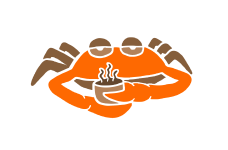
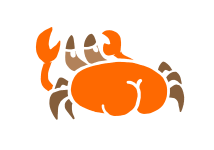

<div align="center">
    
</div>

How the keyboard shows its state (layout, caps lock, macros…) with the LED
and the buzzer.

### From the state to the LED and the songs

The statuses are not stored: after each run of the chew logic,
`Chew::status_bits()` reads them from the state and builds one `u16`
(`StatusBits`), one bit per status.

```
 chew state                       status bits (u16)            output
 ─────────────────────            ─────────────────            ──────────────────────────
 layout.number == 4  ──┐
 layout.number == 5  ──┤                                  ┌──► LED   (lowest bit set)
 leader.active       ──┼──► status_bits() ──► 1000_1010 ──┤
 mods.caplock        ──┤                                  └──► songs (bits changed since
 buzzer_activation   ──┤                                            the last run)
 dynmac.state        ──┘
```

- Code: `src/software/status.rs` (bits, LED, songs), `Chew::status_bits()` in
  `src/software/chew.rs`, `DynMac::status_bits()` in
  `src/software/dynamicmacro.rs`.
- Mono and both halves of the split use the same functions, so they show the
  same thing.

### The bits

| Bit | Status | On while | LED | Song on / off |
|---|---|---|---|---|
| 0 | `BIT_LAYOUT_FR` | layout 4 | aqua | StartupB / reversed |
| 1 | `BIT_LAYOUT_FN` | layout 5 | fuchsia | NotifC / reversed |
| 2 | `BIT_LEADER_KEY` | leader key waiting | blue | NotifA / - |
| 3 | `BIT_CAPLOCK` | caps lock | orange | StartupG / reversed |
| 4 | `BIT_DYNMAC_GO_WAIT` | macro replay, waiting for a key | olive, blinks | NotifF / - |
| 5 | `BIT_DYNMAC_REC` | macro recording | red, blinks | AlertD / - |
| 6 | `BIT_DYNMAC_REC_WAIT` | macro record, waiting for a key | purple, blinks | AlertE / - |
| 7 | `BIT_BUZZER` | buzzer on (B + U + Z) | - | StartupA / reversed |
| 8–15 | free | | | |

### Why one bit per status

There's one LED and one buzzer, so only one status is shown at a time. But
several can be on together, and the bits keep all of them:

- **The hidden status comes back:**
  ```
  caps lock on    → orange
  + FN layout     → fuchsia   (FN wins, caps lock hidden)
  FN released     → orange    (caps lock shows again)
  ```
- **A hidden status still plays its song:**
  ```
  FN + caps lock, then caps lock off
  bits:      0000_1010 → 0000_0010   bit 3 changed → caps lock off song
  "winner":  FN        → FN          no change     → no song
  ```
- **The buzzer bit is not shown:** it says whether songs can play, whatever
  the LED shows.

So the priority (lowest bit wins) picks what to show, no "several statuses"
value is needed.

<div align="center">
    
</div>

### LED

The lowest bit set wins, so the bit number is the priority. The buzzer bit
has no color and is left out.

```
bits     1000_1010      buzzer + caps lock + FN
mask   & 0111_1111      buzzer bit left out
       = 0000_1010
                ^       lowest bit set: 1 (FN) → fuchsia
```

No bit set → LED off (`trailing_zeros` gives 16).

### Songs

Each run compares the new bits with the last ones:

```
last      0000_1000     caps lock
new       0000_1010     caps lock + FN
last^new  0000_0010     bit 1 changed, now on → NotifC
```

- One song per run, from the lowest changed bit that has a song. The other
  changes of that run play nothing.
- Switched off: the same song reversed, or nothing (leader, macros).
- Buzzer toggle: the buzzer is enabled before the song and disabled after it,
  so both toggle songs can be heard (`play_status_songs`).

```
buzzer on   ──► set_active(true) ──► StartupA            ──► (stays active)
buzzer off                       ──► StartupA reversed   ──► set_active(false)
```

<div align="center">
    
</div>

### Split

Only the master runs the chew logic. It sends its status bits to the slave in
every request (STATUS mail, low byte first, see
[SPLIT_LINK.md](./SPLIT_LINK.md#mails)):

```
master                                        slave
  chew.run()
  status_bits()   ──► LED + songs (left part)
  |-- STATUS [low, high, 0] ------------->      mail_to_status()
  |                                             ──► LED + songs (right part)
  |<-- KEYS ------------------------------
```

- Both halves play the same song, each one its own side of it: that's the
  stereo.
- The STATUS mail is a full state, sent every 5 ms: a lost frame only delays
  a change.
- The slave takes its first state (startup, or after a lost link) without
  songs, since it doesn't know what changed in between.
- Lost link: both halves turn the LED red until the link is back.

### Adding a status

1. `status.rs`: a constant on a free bit, e.g. `pub const BIT_NUMLOCK: u8 = 8;`
2. `Chew::status_bits()`: one line, `(BIT_NUMLOCK, self.mods.numlock)`.
3. `status.rs`: optionally a color in `show_status_led` and a song in
   `status_song`.

The link, `mono.rs` and `split.rs` don't change. Past 16 statuses,
`StatusBits` can become a `u32`: only `status_to_mail` / `mail_to_status`
change, the mail has a third byte (24 bits).

<div align="center">
    
</div>
